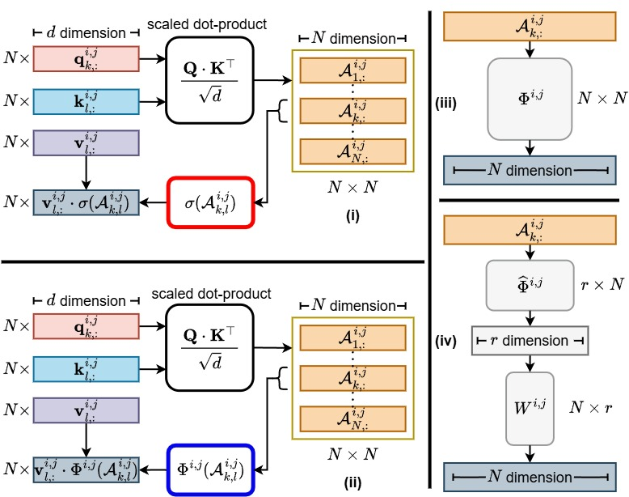

<div align="center">
	<br>
	<center>
  <h1>Kolmogorov-Arnold Attention (KArAt)</h1>
  </center>
	<br>
   <center>
      <a href="https://arxiv.org/abs/2503.10632"></a>
      <a href="https://maitysubhajit.github.io/KArAt"></a>
      <a href="https://github.com/MaitySubhajit/KArAt"></a>
      <br>
      <a href="#rocket-requirements"></a>
      <a href="#environment"></a>
      <a href="https://github.com/MaitySubhajit/KArAt/blob/main/LICENSE"></a>
      <br>
      <br>
      <br>
   </center>
</div>

# Kolmogorov-Arnold Attention: Is Learnable Attention Better for Vision Transformers? :fire:
This is the official implementation of the paper [Kolmogorov-Arnold Attention: Is Learnable Attention Better for Vision Transformers?](https://arxiv.org/abs/2503.10632) by [S. Maity](https://subhajitmaity.io), [K. Hitsman](https://github.com/KillianHitsman), [X. Li](https://sciences.ucf.edu/math/person/xin-li), [A. Dutta](https://sciences.ucf.edu/math/person/aritra-dutta).

### :loudspeaker: Recent Updates
- *8 Jul 2025* : Initial code is now available. If you face any problem, please read the [FAQ & Issues](#mag-faqs-notes-issues) section and raise an issue if necessary.

---

:pushpin: [Requirements](#rocket-requirements)

:pushpin: [Getting Started](#clipboard-getting-started)

:pushpin: [FAQ & Issues](#mag-faqs-notes-issues)

:pushpin: [Credits](#star-credits)

:pushpin: [Citation](#bibtex)

### :wrench: Framework
<div align="center"><center></center></div>

### :bar_chart: Quantitative Performance
|         Model          |        CIFAR-10       |       CIFAR-100       |      ImageNet-1K      |
|:-----------------------|:---------------------:|:---------------------:|:---------------------:|
|  ViT-Base              |         83.45         |         58.07         |         72.90         |
|  + G<sub>1</sub>B      |         81.81         |         55.92         |         68.03         |
|  + G<sub>1</sub>U      |         80.75         |         57.36         |         68.83         |
|  ViT-Small             |         81.08         |         53.47         |         70.50         |
|  + G<sub>3</sub>B      |         79.78         |         54.11         |         67.77         |
|  + G<sub>3</sub>U      |         79.52         |         53.86         |         67.76         |
|  ViT-Tiny              |         72.76         |         43.53         |         59.15         |
|  + G<sub>3</sub>B      |         76.69         |         46.29         |         59.11         |
|  + G<sub>3</sub>U      |         75.56         |         46.75         |         57.97         |

## :rocket: Requirements
- Python 3.11
- torch 2.4.0, torchvision 0.19.0, torchaudio 2.4.0
- timm 1.0.9
- einops 0.8.0
- fvcore 0.1.5.post20221221
- scipy 1.9.3
- numpy 1.26.3
- pillow 10.2
- wandb 0.18.7

## :clipboard: Getting Started
:white_check_mark: [Dataset](#dataset)

:white_check_mark: [Environment](#environment)

:white_check_mark: [Training](#Training)

### Dataset   
- This implementation includes provisioning for six datasets: [CIFAR-10](https://www.cs.toronto.edu/~kriz/cifar.html), [CIFAR-100](https://www.cs.toronto.edu/~kriz/cifar.html), [ImageNet-1K](https://image-net.org/index.php), [SVHN](http://ufldl.stanford.edu/housenumbers), [Flowers 102](https://www.robots.ox.ac.uk/~vgg/data/flowers/102), and [STL-10](https://cs.stanford.edu/~acoates/stl10). Use the below arguments for using each of these datasets.
   - `--data-set CIFAR10` for CIFAR-0
   - `--data-set CIFAR100` for CIFAR-100
   - `--data-set IMNET` for ImageNet-1K
   - `--data-set SVHN` for SVHN
   - `--data-set Flowers102` for Flowers 102
   - `--data-set STL10` for STL-10
- All the datasets except ImageNet-1K will be automatically downloaded. The default directory is `./data/` and can be changed using `--data-path` argument.

- For ImagNet-1K the code expects the data in ImageFolder format as shown below. Pass the ImageNet root directory using `--data-path` argument.

```
├── path/to/imagenet             # ImageNet-1K root directory
   ├── train                     # train set root
   |  ├── class 1
   |  |  ├── image 1.jpeg
   |  |  ├── image 2.jpeg
   |  |  ├── ...
   |  |
   |  ├── class 2
   |  |  ├── image 1.jpeg
   |  |  ├── image 2.jpeg
   |  |  ├── ...
   |  |
   |  ├── class 3
   |  |  ├── ...
   |  |
   |  └── class 1000
   |     ├── image 1.jpeg
   |     ├── image 2.jpeg
   |     ├── ...
   |
   └── validation                # train set root
      ├── class 1
      |  ├── image 1.jpeg
      |  ├── image 2.jpeg
      |  ├── ...
      |
      ├── class 2
      |  ├── image 1.jpeg
      |  ├── image 2.jpeg
      |  ├── ...
      |
      ├── class 3
      |  ├── ...
      |
      └── class 1000
         ├── image 1.jpeg
         ├── image 2.jpeg
         ├── ...
```

### Environment
You can install the reqired packages on a Python 3.11 installation as given in [requirements](#rocket-requirements) or you can install using the below command.
```
pip install -r requirements.txt
```

### Training
This implementation is based on the [DeiT codebase](https://github.com/facebookresearch/deit) and retains most of its original functionalities, despite most of them never being used here. Below is a brief overview of the available arguments.

- `--model` argument specifies the name of the model to train. We have six available models as following.
   - `vit_tiny_patch16_224`
   - `vit_small_patch16_224`
   - `vit_base_patch16_224`
   - `vit_tiny_patch16_224_karat`
   - `vit_small_patch16_224_karat`
   - `vit_base_patch16_224_karat`
- We keep the standard arguments as set by the [DeiT repository](https://github.com/facebookresearch/deit). Please follow the same arguments setup for this implementation. This includes the common hyperparameters.
   - Model realted hyperparameters: `--drop` and `--drop-path`.
   - Common training hyperparametrs: `--batch-size` (default 64), `--epochs` (default 100).
   - Choice of optimizer using `--opt` (deafult AdamW) and related hyperparameters: `--opt-eps`, `--opt-betas`, `--clip-grad`, `--momentum`, `--weight-decay`.
   - Choice of learning rate scheduler `--sched` (default cosine), base learnning rate `--lr` (default 5×10<sup>-4</sup>), and other scheduler related hyperparameters: `--warmup-lr`, `--min-lr`, `--decay-epochs`, `--warmup-epochs`, `--decay-rate`.
   - Arguments related to data augmentation: `--color-jitter`, `--smoothing` etc.
- Please use the `--output_dir` argument to set the directory path where training logs and checkpoint are to be saved. The deafult path is an empty string which signifies no saving.
- Please use `--device` to set the training device. The default device is `cuda`.
- `--run_name` and `--run_id` arguments are used by [Weights and Biases](https://wandb.ai) logging. `--run_name` is used to provide a job name in Weights and Biases, and if not passed, it disables Weights and Biases logging. `--run_id` is only used to provide the existing job identifier while resuming a job.
- The hyperparameters related to KArAt are as the following.
   - `--base_fn` for setting the base activation function. The default is a custom function `ZeroModule` which ensures no base function. Any standard function from `torch.nn` can be used. eg. `--base_fn nn.SiLU` or `--base_fn nn.ReLU`
   - `--basis_type` type of the basis function for KArAt. The deafult is `FourierBasis` and the other choices are `SplineBasis`, `WaveletBasis`, and `RationalBasis`.
   - `--grid` for the gridsize G in Fourier and Spline basis.
   - `--order` for the order of the Spline.
   - `--grid_range` for the grid range of the Spline.
   - `--wavelet_type` for determining the type of Wavelet when using Wavelet basis. The choices are `mexican_hat`, `morlet`, `dog`, `meyer`, and `shannon`.
   - `--rational_order` for specifying the numerator and denominator of the Rational basis.
   - `--depth` for the number of total layers in a KArAt module. The default is 2, one KAN layer and one Linear Projection layer.
   - `--hidden_dim` is the low rank inner dimension r. The default is 12.
   - `--mixed_head` argument is used to enable training with KArAt and softmax attention heads simulataneously. `--num_attention` argument determines the number of KArAt heads and the rest of the heads are softmax. If not mentioned, this defaults to 1, 3, and 6 for ViT Tiny, Small and Base respectively. This is not used at all in the main work.
   - `--universal` to enable Universal mode and `--blockwise`for the Blockwise mode of KArAt. The default is Blockwise mode.
   - `modular_attn` is used to enable different types of layers in a KArAt module instead of only KAN layers. This is used in the main work.
   - `--modular_mode` is used for determining the order of KAN layer and Linear Projector. The available choices are `w1_phi2` and `phi1_w2`. The default is set to `phi1_w2` which is presented in the main work.
   - `--project_l1` argument is used to enable projection on L<sub>1</sub> ball after KArAt activation to ensure the values are bounded between 0 and 1 and sum up to 1. This is not used in the main work.
   - `--basis_not_trainable` and `--base_not_trainable` arguments are used to freeze the learnable parameters in the Basis function and Base Activation function respectively.
   - `--attn_lr` is used to set a different learning rate for the KArAt modules. The default value is none, which falls back the base learning rate.

To train ViT-Tiny + Fourier KArAt G<sub>3</sub>B with Blockwise mode, use the following command.
```
python main.py --model vit_tiny_patch16_224_karat --batch-size 128 --data-path path/to/imagenet --data-set IMNET --output_dir ./output/vit_tiny_patch16_224_FourierKArAt_G3B --epochs 100 --num_workers 8 --grid 3 --hidden_dim 12 --basis_type FourierBasis --base_fn ZeroModule --base_not_trainable --modular_attn --modular_mode phi1_w2 --blockwise
```

To train ViT-Tiny + Fourier KArAt G<sub>3</sub>U with Universal mode, use the following command.
```
python main.py --model vit_tiny_patch16_224_karat --batch-size 128 --data-path path/to/imagenet --data-set IMNET --output_dir ./output/vit_tiny_patch16_224_FourierKArAt_G3U --epochs 100 --num_workers 8 --grid 3 --hidden_dim 12 --basis_type FourierBasis --base_fn ZeroModule --base_not_trainable --modular_attn --modular_mode phi1_w2 --universal
```

### Multi-GPU Training
To train on `n` GPUs please use `torchrun --nproc_per_node=n main.py` instead of `python main.py`, and keep the rest of the argument parsing as it is. Please note that the effective batch size in Multi-GPU scenario is batch size * n.

### Evaluation
For evaluation, use `--resume /path/to/checkpoint.pth` argument to provide weights and `--eval` flag along with the rest of the arguments.

### Finetuning
For finetuning a pre-trained model use `--finetune /path/to/pretrained_checkpoint.pth` for providing pre-trained checkpoint along with the rest of the arguments.

## :mag: FAQs, Notes, Issues
- Our experimental settings used 32 GB of memory and H100 GPUs with 8 workers in the dataloader. Training may be slower if this specifications are not met.

*If you are facing a problem not listed here, please raise an issue.*

## :star: Credits
The codebase is directly adapted from [DEiT](https://github.com/facebookresearch/deit) and id heavily inspired from the following wonderful open-source repositories.
- [DINO](https://github.com/facebookresearch/dino)
- [KAN vs. MLP](https://github.com/yu-rp/KANbeFair)
- [Fourier KAN](https://github.com/GistNoesis/FourierKAN)
- [Wav KAN](https://github.com/zavareh1/Wav-KAN)
- [KAT](https://github.com/Adamdad/kat)

## BibTeX  
If you use our code for your research, please cite our paper. Many thanks!

```
@article{maity2025karat,
  title={Kolmogorov-Arnold Attention: Is Learnable Attention Better For Vision Transformers?},
  author={Maity, Subhajit and Hitsman, Killian and Li, Xin and Dutta, Aritra},
  journal={arXiv preprint arXiv:2503.10632},
  year={2025}
}
```